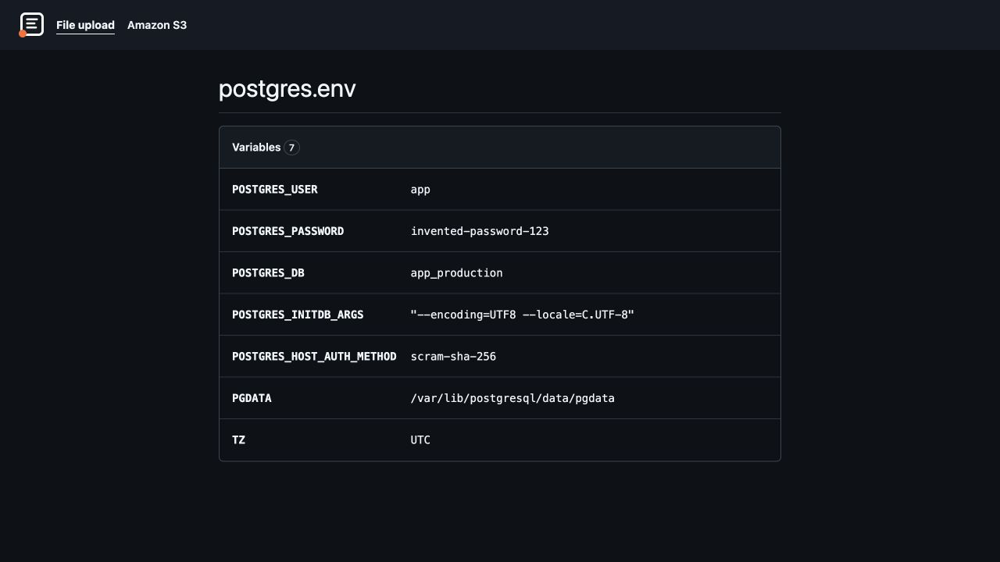

# envs

envs is a web app with the look of GitHub for people who inspect container configuration. You can view and edit env files for Docker and Amazon ECS containers.



## Why

envs shows a value exactly as a container gets it. A dotenv library reads the same file differently.

An invented PostgreSQL configuration:

```env
# PostgreSQL container settings
POSTGRES_USER=app
POSTGRES_PASSWORD=invented-password-123
POSTGRES_DB=app_production
POSTGRES_INITDB_ARGS="--encoding=UTF8 --locale=C.UTF-8"
POSTGRES_HOST_AUTH_METHOD=scram-sha-256
PGDATA=/var/lib/postgresql/data/pgdata
TZ=UTC
```

For `POSTGRES_INITDB_ARGS`, containers keep the double quotes as part of the value, while dotenv libraries remove them. The two disagree; envs shows what the container gets.

## Quick start

You need Ruby 3.4.12 and Bundler. The app uses Rails 8.1 and SQLite.

1. Clone the repository:

   ```sh
   git clone https://github.com/gowda/envs.git
   ```

2. Enter the clone:

   ```sh
   cd envs
   ```

3. Install the gems, prepare the database and start the server:

   ```sh
   bin/setup
   ```

4. Open <http://localhost:3000>, which redirects to `/files`.
5. Save the example from **Why** as `postgres.env` and drop it on the page. The list shows seven variables, and the value of `POSTGRES_INITDB_ARGS` includes its quotes.

## Use

### View an uploaded file

Open `/files` and drop a UTF-8 env file of 1 MB or less, or choose **Select an env file**. The app stores valid uploads and opens `/files/<public ID>`, where you can view variables in file order. Keep that URL to return: the app has no list of stored uploads.

### Work with S3

Open `/s3` and select **Refresh from S3**. Open a file card, select **Edit** beside a variable, change its value and select **Save**. Select **Review & publish**, check the difference, then select **Publish**. See [S3](docs/s3.md) for refresh and publish details.

## Configuration

Settings and secrets come from environment variables. Restart the app after changing a setting.

| Variable | Purpose |
| --- | --- |
| `ENVS_S3_BUCKET` | Required bucket name for S3 access. |
| `ENVS_S3_PREFIX` | Optional listing prefix; defaults to an empty prefix. |
| `AWS_REGION` | AWS region for the bucket. |
| `ENVS_ENCRYPTION_KEY` | Required primary key for Active Record encryption of S3 snapshots and local edits. |

Use the standard AWS credential chain. Grant `s3:ListBucket` on the bucket, plus `s3:GetObject` and `s3:PutObject` on the selected objects.

Generate an encryption key:

```sh
openssl rand -hex 32
```

Keep the key stable and secure: existing snapshots need the same key. See [S3 configuration](docs/s3.md#configuration) for encryption details.

## How env files are read

The first `=` separates a name from its literal value. Quotes, spaces, commands and references stay as written. Repeated names stay visible, but only the last line takes effect. See the [env file format](docs/env-file-format.md) for validation and warnings.

## How it works

SQLite holds S3 snapshots and local edits, with their content encrypted through Active Record encryption. Local edits are stored beside the snapshot and shown on the page. The snapshot changes only after a publish succeeds. An ETag is a tag that S3 changes when an object's content changes. A publish uses the stored ETag as a condition to avoid overwriting a changed object.

Active Storage keeps uploads on local disk under `storage/`; test uploads use `tmp/storage/`. Stimulus through importmap handles file selection and drop uploads. The app does not load uploaded variables into its environment.

## Limits

- The app has no login. Each person who can reach the app can see every file and can publish. A stored upload's page needs no session.
- Stored uploads are unencrypted and cannot be deleted in the app.
- Only valid S3 files are editable.
- Publishing does not keep object tags, the ACL (access control list), cache settings or storage class.

## Development

You can also start the server with `bin/rails server`. Run `bundle exec rspec` for specs and `bin/ci` for local checks and specs. Examples and test files use invented values; don't commit secrets. If you use a coding agent, it reads [AGENTS.md](AGENTS.md).

The interface uses vendored Primer CSS 21.5.1 under the MIT licence.

## Security

The app encrypts S3 snapshots and local edits. It does not write a value to the log or to a URL. Don't put a real value in an issue when reporting a problem.
